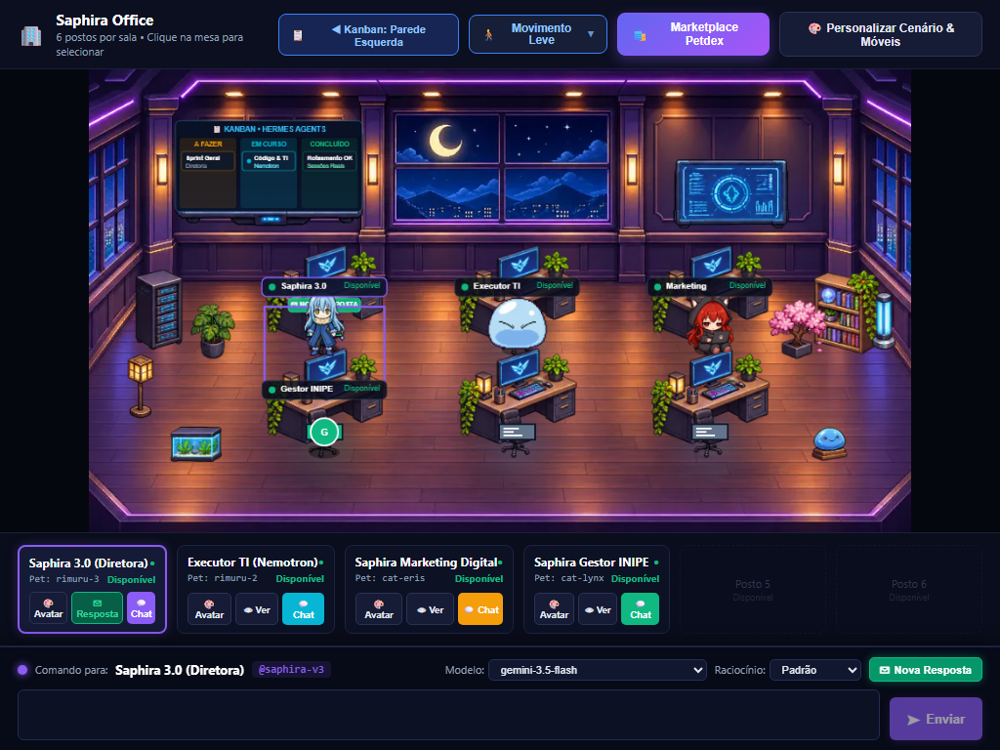
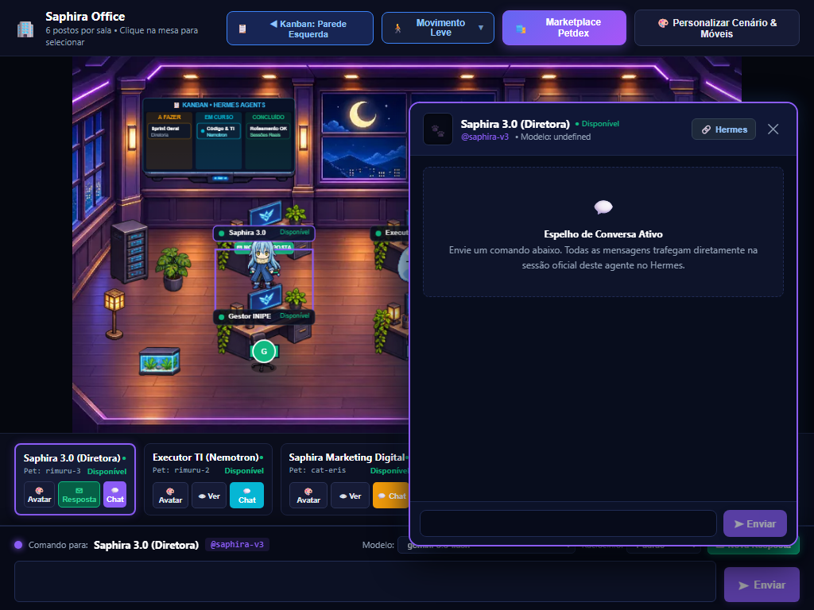
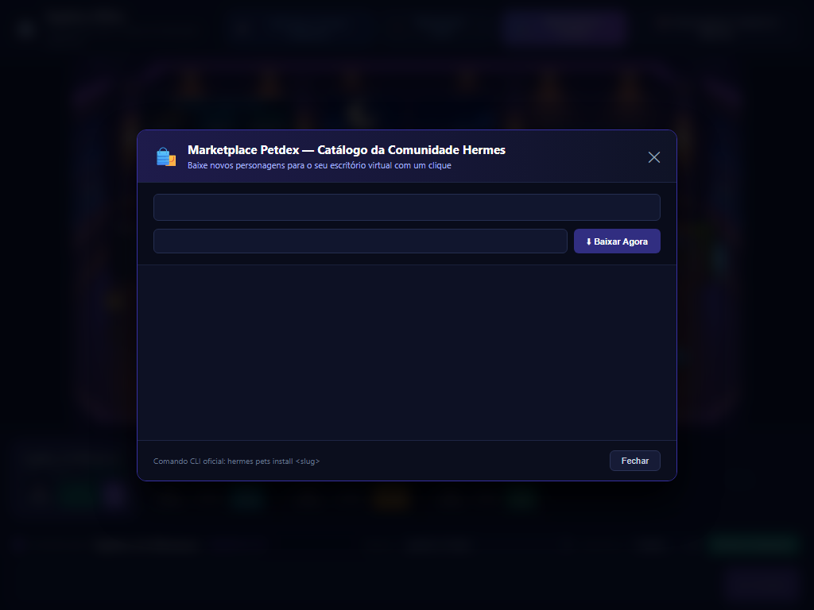
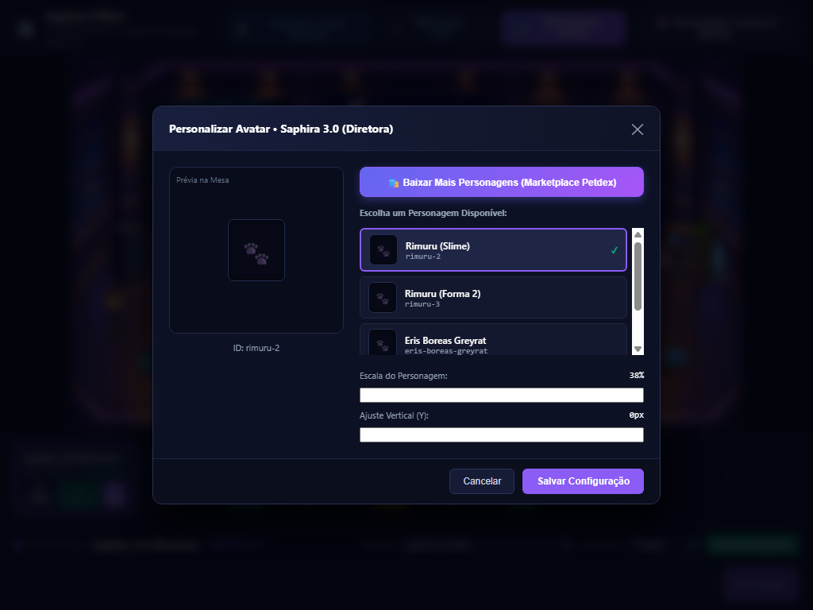

# Saphira Office 🏢✨

> **Animated Virtual Pixel Art Office for Hermes Desktop Agents & Profiles**

[](https://opensource.org/licenses/MIT)
[](https://hermes-agent.nousresearch.com)
[](https://github.com/caiquenzt-lang/saphira-office)

**Saphira Office** transforms your [Hermes Desktop](https://hermes-agent.nousresearch.com) workspace into a cozy, living 16-bit virtual office. Your AI profiles and agents are automatically discovered and placed at workstations where they animate, walk around, sit at their desks, and react in real-time as they think, execute tools, and complete tasks.



---

## 🌟 Key Features

- 🤖 **Zero-Config Profile Discovery:** Automatically scans your local Hermes installation (`host.profiles.list()`, `host.agents()`) and maps all your agents into dedicated desk workstations.
- 💬 **Live Chat Mirror Popup:** Open a sleek floating chat window for any agent with a single click. Inspect live message history, markdown responses, and thought processes directly inside the virtual office.
- 🗂️ **Retractable Session Selector:** Switch between conversation sessions or spin up brand new sessions (`+ Nova Sessão`) on the fly right from the chat header.
- ⌨️ **Bottom Command Bar:** Broadcast prompts and instructions to any agent directly from the office bottom bar with dedicated model and reasoning status selectors.
- 🐾 **Petdex & Marketplace Integration:** Compatible with the official Hermes Pet system. Preview, download, and adopt custom pet avatars from the community catalog without leaving the office.
- 🎨 **Modular Scene Customizer:** Change office wallpapers (Night Tech, Cyber Neon, Cozy Amber), desk colors, lighting fixtures, and decorative plants.
- 📋 **Integrated Kanban Shortcut:** Click the wall TV screen to jump straight into Hermes Desktop's native Kanban board (`/kanban`).
- 🌐 **Full Multi-Language Support (i18n):** Automatically follows Hermes Desktop language preferences (`display.language` / `ctx.i18n`) with complete English (`en`) and Brazilian Portuguese (`pt-BR`) dictionaries, plus an instant language switcher (`🌐 Auto | EN | PT`) on the top bar.
- ⚡ **Embedded Core Assets & Optional Petdex:** All default office backgrounds, furniture tiles, and built-in agent sprites are 100% embedded and functional offline without tracking. When opened, the optional Petdex Marketplace modal queries the community catalog at petdex.dev to let you discover and install optional community character sprites.

---

## 📸 Screenshots

| Command Bar & Active Working Status | Built-in Chat Mirror & History |
|:---:|:---:|
|  |  |

| Petdex Marketplace Integration | Modular Office Customizer |
|:---:|:---:|
|  |  |

---

## 🚀 Installation

### Option 1: Via Hermes Plugin Catalog (Recommended)

Once merged into the official catalog:
```bash
hermes plugins install saphira-office
hermes plugins enable saphira-office
```

### Option 2: Via Git URL

Install directly from this repository with the Hermes CLI:
```bash
hermes plugins install https://github.com/caiquenzt-lang/saphira-office
hermes plugins enable saphira-office
```

### Option 3: Manual Installation (Desktop Plugins Folder)

1. Clone or download this repository:
   ```bash
   git clone https://github.com/caiquenzt-lang/saphira-office.git
   ```
2. Copy the folder to your Hermes desktop plugins directory:
   - **Windows:** `%LOCALAPPDATA%\hermes\desktop-plugins\saphira-office`
   - **macOS / Linux:** `~/.hermes/desktop-plugins/saphira-office`
3. Restart or reload plugins in Hermes Desktop (`Ctrl+K` or `Cmd+K` → *Reload desktop plugins*).

---

## 🎮 How to Use

1. **Opening the Office:**
   - In Hermes Desktop, click **Saphira Office** in the left sidebar navigation, or use the Command Palette (`Ctrl+K` → *Saphira Office*).
2. **Interacting with Agents:**
   - **Click on a desk or monitor:** Selects that agent and summons them to their chair.
   - **Click `💬 Chat` or `👁️ Ver`:** Opens the floating Chat Mirror for that profile.
   - **Type in the bottom bar:** Sends commands directly to the selected agent's official session.
3. **Changing Movement Modes:**
   - Use the top navigation dropdown to choose between:
     - 🛑 **Parados na Mesa:** Keep all agents seated at their desks.
     - 🚶 **Movimento Leve:** Relaxed ambient walking.
     - ⚡ **Movimento Rápido:** Fast-paced active office.
4. **Customizing Furniture & Pets:**
   - Click **Personalizar Cenário & Móveis** in the top bar to change wallpapers, desks, and decor.
   - Click **Marketplace Petdex** to download and adopt new community avatars.

---

## 🧩 Compatibility & Requirements

- **Hermes Desktop:** `>= 0.19.0` (tested and fully homologated on `v0.23.0`).
- **Dependencies:** None. Powered natively by `@hermes/plugin-sdk` and standard HTML5 Canvas 2D.
- **Operating Systems:** Windows 10/11, macOS, Linux.

---

## 🧪 Running Tests

To run the local unit and contract test suite:
```bash
npm test
```
The test suite validates:
- Desktop Plugin SDK contract compliance (`test_plugin_contract.mjs`).
- Polymorphic chat history parsing & session switching (`test_chat_mirror.mjs`).
- Gateway RPC routes (`prompt.submit`, `session.resume`, `session.list`, `pet.gallery`).

---

## 📄 License

This project is licensed under the [MIT License](./LICENSE).

Pixel art assets and animations are inspired by retro game management aesthetics and designed for the open-source Hermes AI ecosystem.


---

## 🇧🇷 Documentação em Português

### Sobre o Saphira Office
O **Saphira Office** transforma o seu Hermes Desktop em um aconchegante escritório virtual em pixel art 16-bit. Seus perfis e agentes do Hermes são detectados automaticamente e alocados em mesas de trabalho, onde eles se movimentam, sentam, trabalham e reagem visualmente conforme processam pensamentos, executam ferramentas e concluem tarefas.

### Principais Recursos
- 🤖 **Descoberta Automática de Agentes:** Mapeia todos os seus perfis configurados sem necessidade de configuração manual.
- 💬 **Chat Espelho Integrado:** Visualize o histórico oficial de mensagens, respostas e raciocínio de cada agente em uma janela flutuante.
- 🗂️ **Seletor de Sessões:** Alterne entre diferentes conversas ou crie uma nova sessão de chat diretamente pela interface do escritório.
- ⌨️ **Barra de Comandos:** Envie instruções para qualquer agente com seleção de modelo e esforço de raciocínio.
- 🐾 **Marketplace Petdex:** Baixe e aplique novos avatares da comunidade oficial do Hermes com um clique.
- 🎨 **Personalização de Cenário:** Troque mesas, cadeiras, papéis de parede e decorações.
- 🌐 **Suporte Multilíngue (i18n):** Detecção automática do idioma do Hermes Desktop (`en` e `pt-BR`) com seletor manual rápido no topo (`🌐 Auto | EN | PT`).

### Como Instalar no Hermes
```bash
hermes plugins install saphira-office
```
Ou clonando o repositório na pasta de plugins do Hermes Desktop:
```bash
cd %LOCALAPPDATA%\hermes\desktop-plugins
git clone https://github.com/caiquenzt-lang/saphira-office.git
```
