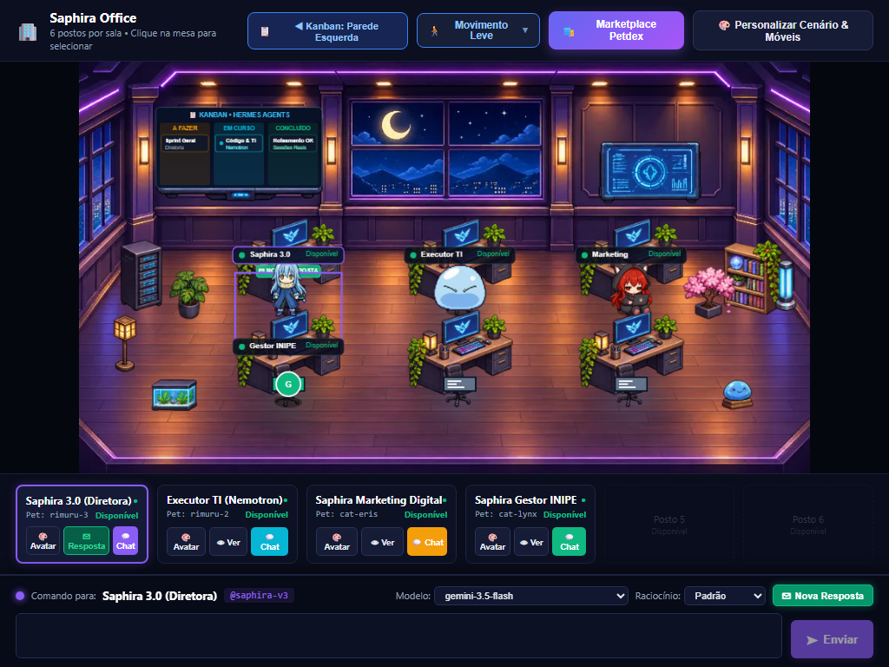

# Saphira Office 🏢✨ (Versão em Português)

> **Escritório Virtual Animado em Pixel Art para Perfis e Agentes do Hermes Desktop**

[](https://opensource.org/licenses/MIT)
[](https://hermes-agent.nousresearch.com)
[](https://github.com/caiquenzt-lang/saphira-office)

O **Saphira Office** transforma o seu [Hermes Desktop](https://hermes-agent.nousresearch.com) em um escritório virtual animado em estilo 16-bit. Seus perfis e agentes de IA configurados no Hermes são detectados automaticamente e posicionados em suas estações de trabalho, onde andam pelo cenário, sentam-se à mesa e reagem visualmente em tempo real enquanto pensam, executam ferramentas e concluem tarefas.



---

## 🌟 Principais Recursos

- 🤖 **Detecção Automática de Perfis:** Varre automaticamente os perfis locais do seu Hermes (`host.profiles.list()`, `host.agents()`) e os distribui nas mesas de trabalho do escritório.
- 💬 **Chat Espelho Integrado:** Abra um popup compacto e flutuante de chat com um clique no agente. Veja o histórico oficial da conversa, respostas formatadas em Markdown e o status de raciocínio.
- 🗂️ **Seletor Retrátil de Sessões:** Alterne facilmente entre conversas anteriores ou inicie uma nova sessão (`+ Nova Sessão`) diretamente pelo cabeçalho do chat.
- ⌨️ **Barra de Comandos Inferior:** Envie instruções, dúvidas e tarefas diretamente ao agente selecionado sem precisar sair do escritório virtual.
- 🐾 **Integração com Petdex e Marketplace:** Compatível com o sistema oficial de Pets do Hermes. Visualize miniaturas, baixe e adote avatares da comunidade instantaneamente.
- 🎨 **Personalização de Cenário e Móveis:** Escolha entre papéis de parede (Night Tech, Cyber Neon, Cozy Amber), estilos de mesa, iluminação e decorações.
- 📋 **Atalho para o Kanban Nativo:** Clique na televisão da parede para acessar diretamente o quadro Kanban integrado do Hermes Desktop (`/kanban`).
- ⚡ **100% Autossuficiente e Seguro:** Todos os sprites e animações estão embutidos. Zero conexões externas desnecessárias, seguro e funciona completamente offline.

---

## 🚀 Como Instalar

### Opção 1: Pelo Catálogo Oficial do Hermes (Recomendado)

Após aprovação no catálogo oficial da comunidade:
```bash
hermes plugins install saphira-office
hermes plugins enable saphira-office
```

### Opção 2: Pelo Repositório Git Direto

Instale diretamente a partir deste repositório usando o CLI do Hermes:
```bash
hermes plugins install https://github.com/caiquenzt-lang/saphira-office
hermes plugins enable saphira-office
```

### Opção 3: Instalação Manual (Pasta Desktop Plugins)

1. Clone ou baixe este repositório:
   ```bash
   git clone https://github.com/caiquenzt-lang/saphira-office.git
   ```
2. Copie a pasta do projeto para o diretório de plugins do Hermes Desktop:
   - **Windows:** `%LOCALAPPDATA%\hermes\desktop-plugins\saphira-office`
   - **macOS / Linux:** `~/.hermes/desktop-plugins/saphira-office`
3. No Hermes Desktop, recarregue os plugins (`Ctrl+K` ou `Cmd+K` → *Reload desktop plugins*).

---

## 🎮 Como Usar

1. **Abrindo o Escritório:**
   - No Hermes Desktop, clique em **Saphira Office** no menu lateral esquerdo ou use a paleta de comandos (`Ctrl+K` → *Saphira Office*).
2. **Interagindo com os Agentes:**
   - **Clique na mesa ou computador:** Seleciona o agente e chama-o para sua cadeira.
   - **Clique em `💬 Chat` ou `👁️ Ver`:** Abre o Chat Espelho flutuante do perfil.
   - **Digite na barra inferior:** Envia comandos para a sessão oficial do agente no Hermes.
3. **Modos de Movimento:**
   - Alterne no menu superior entre:
     - 🛑 **Parados na Mesa:** Todos os agentes sentados em seus postos.
     - 🚶 **Movimento Leve:** Caminhada suave e ambiente.
     - ⚡ **Movimento Rápido:** Movimentação ativa e ágil pelo escritório.

---

## 🧪 Executando os Testes

Para executar a suíte de testes de contrato e integração:
```bash
npm test
```

---

## 📄 Licença

Distribuído sob a licença [MIT](./LICENSE).
